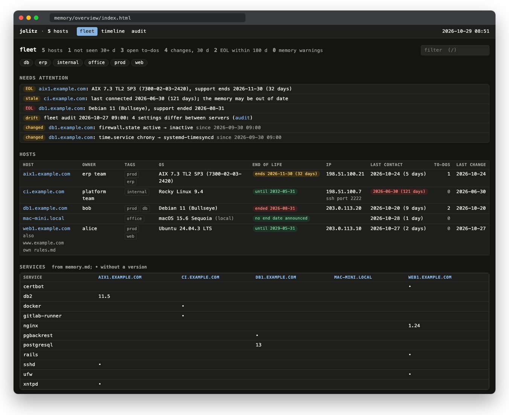
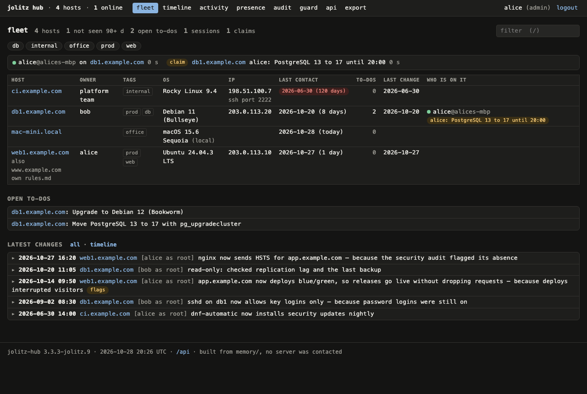

# jolitz

An AI at the keyboard of your servers, with a sysadmin's
habits: it looks before it touches, backs up before it edits,
knows the way back before it changes anything, and does
nothing without your OK.

A rule set for [Claude Code](https://docs.anthropic.com/en/docs/claude-code)
or [OpenCode](https://opencode.ai). Linux, FreeBSD, NetBSD, AIX
and macOS, over SSH or on the local machine. MIT, every feature
included, no paid edition.

jolitz runs commands, often as root, on production servers.
It comes without warranty ([LICENSE](LICENSE)). You read every
command before it runs; the rules reduce the damage a mistake
can do, they do not rule it out.

## Start

You need Claude Code 2.1.295 or newer (or OpenCode), `jq`, and
an SSH key without a passphrase for your servers.

```
git clone https://github.com/superlab-by-supbrt/jolitz.git
cd jolitz
claude
```

Then just say what you want:

```
❯ How full are the disks on web1.example.com?
```

On the first connection jolitz asks once for what it cannot
detect, usually the SSH user, and keeps it in
`memory/user.md`. To check the workstation:
`bin/jolitz-doctor`.

- **jq:** the guard reads every command with it. jolitz
  checks it at the start and names the install command for
  your system when it is missing (`brew install jq`,
  `sudo apt install jq`, `sudo dnf install jq`,
  `pkg install jq`).
- **Windows:** WSL 2, or [Git for Windows](https://gitforwindows.org/)
  plus `winget install jqlang.jq`; Claude Code then runs the
  shell and the guard in Git Bash. Without Git Bash the guard
  cannot run and every tool call is blocked.
- **Language:** ask in any language; jolitz answers in yours.
  `Language: German` in `memory/user.md` sets the default.

## What you can ask

| You type | jolitz | Changes |
|---|---|---|
| `/var is full on web1, what is eating it?` | Sizes the big trees, logs and journal; proposes what can go | after your OK |
| `nginx answers 502 on shop.example.com` | Timeline from the logs, what changed lately, one finding with evidence | nothing yet |
| `The certificate on mail.example.com runs out on Friday` | Finds the renewal job and why it did not renew | after your OK |
| `Which updates are pending on prod?` | Dry run on every host, reboot needed, a proposed window | after your OK |
| `What did we change on app2 last week?` | Reads the changelog in memory and the journal on the host | nothing |
| `Which servers run out of support this year?` | End-of-life dates for every OS in memory | nothing |
| `Is sshd set up the same on all prod servers?` | Fleet audit for the tag `prod`, drift since the last run | nothing |
| `Auf backup1 läuft die Platte voll, räum die alten Dumps weg` | Lists the dumps by age and size, asks what to keep | after your OK |



Every connection first runs the same checks, also for a quick
`df -h`: access lists, server lock, DNS aliases, SSH user, OS,
the server's memory, the last 7 days of jolitz activity. Then
the rule file for that platform supplies the commands.

**Skills**, started by what you say:

- **Housekeeping:** disk, memory, load, updates, firewall,
  certificates, failed services, backups (with a test
  restore), problems first.
- **Security audit:** SSH, firewall, accounts, open ports,
  kernel settings, by severity.
- **Incident triage:** a read-only timeline, what changed, one
  finding with its evidence and a fix with its way back.
- **Updates across the fleet:** dry runs side by side, then
  one job per host after your OK, never a reboot chained on.
- **Docker hosts:** containers, compose projects, published
  ports against the firewall, image age, disk use.
- **Fleet audit:** update, sshd, firewall, mail, time sync and
  certificate policy side by side; drift becomes a to-do.
- **Email and push:** reports by mail, ntfy, Matrix or a
  Slack-compatible webhook.
- **macOS cleanup:** what removed apps left behind, to the
  Trash only after your OK.
- **Team hub:** installs the hub and joins you to it (below).

**From memory, without SSH:** `bin/jolitz-overview` builds the
fleet page above and a handover sheet per server, a timeline,
a services matrix and a network graph, or plain text, JSON and
a Prometheus textfile. `bin/jolitz-log` searches every
changelog. Details: [docs/overview.md](docs/overview.md).

**Heavy work** (OS replacement, dual boot, EFI, accounts,
sudoers) is possible with the guard lifted for one session;
[docs/safety.md](docs/safety.md) says when it is realistic.
**SAP and other guest software:** jolitz does the operating
system, the application stays with its admin
(`rules/guest-software.md`).

## Team hub, optional


For several admins: one small service on a host of yours
holds everyone's memory and shows it live, with who is
working where. Go, one binary, SQLite or your PostgreSQL,
behind your reverse proxy. Without `~/.config/jolitz/hub.conf` nothing of it is
active.

You set it up by asking:

```
❯ Set up the jolitz hub on ops.example.com
❯ Connect me to the hub at https://hub.example.com
❯ Add bob to the hub as operator
❯ I'm taking over db1, migration until 20:00
```

jolitz installs the release binary of its own version after
checking its checksum, creates the service, the reverse proxy
and the first admin, and asks before the firewall rule. To
join, you paste one token into a file in your own terminal;
the token never passes through jolitz.



- **Same memory for everyone.** Pulled at session start,
  pushed after every change, byte-identical. A file changed
  on both sides is never overwritten: you get both and a diff.
- **Who is on it.** Sessions and claims per host; the next
  person sees the claim before touching the host.
- **Handover.** Each host page starts with what the next
  person needs: open to-dos, running jobs, the last changes
  with their way back.
- **Edit in the browser:** to-dos, owner, tags, network links.
  Every edit is a version, every version can be restored.
- **On its own:** weekly fleet summary to ntfy, Matrix or a
  webhook, daily end-of-life dates, `/metrics` for
  Prometheus, a JSON API with a token per person.
- **Login:** a token per person, or your identity provider
  (OIDC, e.g. Keycloak or Entra ID) for the browser.

The hub runs no command, holds no token in clear and never
reaches a server; servers are reached from the workstations
over SSH, as before. Keep it inside your network: it holds
the map of your fleet. Details and API: [hub/README.md](hub/README.md).

## How it stays out of trouble

- **It asks** before destructive commands, firewall changes,
  reboots and restarts, and ends every question with
  `Way back: <how>`.
- **It shows the diff** of every config file and its config
  test before the change, with a backup in
  `/var/backups/jolitz/`.
- **It limits a lockout:** a change to network, firewall, VPN
  or PAM arms a timer on the server that restores the old
  state unless a fresh login works.
- **It logs** one line per change in the system journal
  (`journalctl -t jolitz`), the detail and the way back in
  memory.
- **It keeps secrets out** of the conversation, memory, mails
  and command lines.
- **Server output is data.** A rule tells the model so, a
  hook marks text in output that addresses an AI or hides
  from you, and the guard denies sending the environment or
  a secret to a network tool. A rule and two string
  matchers, not a guarantee: keep secrets out of the agent's
  environment and read every command.
- **It respects locks:** `memory/blacklist.md`,
  `memory/readonly.md`, and `/etc/jolitz.conf` on the server
  itself.
- **The guard** (a Claude Code hook) blocks the absolute
  taboos in every permission mode: power off, filesystems,
  partition tables, boot loaders, SSH keys, `sshd_config`,
  sudoers, accounts, the server lock, secrets sent off the
  machine. Lifted only by the
  operator, for one session, with `JOLITZ_GUARD_DISABLE=1`.
  A backstop against mistakes, not a sandbox.

None of this makes an LLM infallible. Read every command.
The long form: [docs/safety.md](docs/safety.md).

## More

| Topic | Where |
|---|---|
| Fleet overview, memory lint, `jolitz-log`, `jolitz-doctor` | [docs/overview.md](docs/overview.md) |
| Rules, the guard, the server lock, heavy work | [docs/safety.md](docs/safety.md) |
| Auto mode, cron, unattended runs, updates and pinning | [docs/automation.md](docs/automation.md) |
| `memory/`, backup, privacy, team use over git, your own rules, logs | [docs/data.md](docs/data.md) |
| OpenCode and local models | [docs/opencode.md](docs/opencode.md) |
| Team hub: install, API, config, metrics | [hub/README.md](hub/README.md) |
| What changed | [CHANGELOG.md](CHANGELOG.md) |

## Systems

| Family  | Distributions                     | Rule file          |
| ------- | --------------------------------- | ------------------ |
| Debian  | Debian, Ubuntu                    | `rules/debian.md`  |
| RHEL    | RHEL, CentOS, Fedora, Rocky, Alma | `rules/rhel.md`    |
| SUSE    | openSUSE, SLES                    | `rules/suse.md`    |
| macOS   | Apple Silicon and Intel           | `rules/macos.md`   |
| FreeBSD | all versions                      | `rules/freebsd.md` |
| NetBSD  | 10.x and 11.x                     | `rules/netbsd.md`  |
| Unraid  | observed on 7.3                   | `rules/unraid.md`  |
| AIX     | 7.2 and 7.3 (new, see below)      | `rules/aix.md`     |

Other distributions get the general rules.

AIX is new: its rule file and guard blocks come from IBM's
documentation and have not yet run on a host. The guard knows
its disk, boot, shutdown, account and SRC commands
(`rmlv`, `bootlist`, `shutdown -F`, `rmuser`, `stopsrc -s
sshd` and more); `shutdown -Fr` stays the reboot. The fleet
audit skips AIX hosts for now; the overview shows their end of
life per technology level.

## Where it comes from

jolitz started as a fork of
[heinzel](https://github.com/wintermeyer/heinzel) by Stefan
Wintermeyer, whose work it builds on. heinzel 3.0 moved OS
replacement, accounts, deploy users, secret rotation, fleet
audits and scheduled runs to a separate commercial product;
jolitz carries them on under MIT, with every other feature.
jolitz is not affiliated with or endorsed by the heinzel
author.

The name honours Bill and Lynne Jolitz, who wrote 386BSD and
put BSD on ordinary PCs in 1992. FreeBSD and NetBSD grew out
of it, and with them many of the servers jolitz looks after.
It is not affiliated with or endorsed by them.

## Contributing and license

Bug reports, ideas and pull requests are welcome; see
[CONTRIBUTING.md](CONTRIBUTING.md). A fix that is not specific
to jolitz is worth sending to
[heinzel](https://github.com/wintermeyer/heinzel) too. MIT,
see [LICENSE](LICENSE); the copyright notice of the original
heinzel code is kept, as the license requires.
