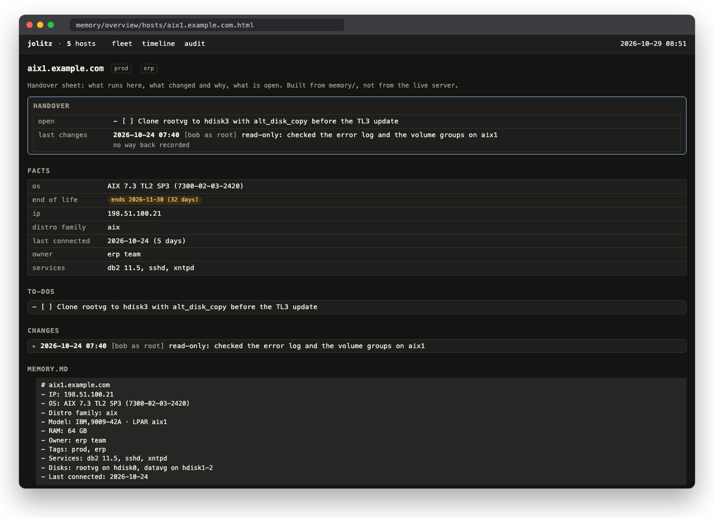

# jolitz

An AI at the keyboard of your servers, with a sysadmin's
habits: it looks before it touches, backs up before it edits,
knows the way back before it changes anything, and does
nothing without your OK.

jolitz is a rule set for a terminal AI tool
([Claude Code](https://docs.anthropic.com/en/docs/claude-code),
[OpenCode](https://opencode.ai) or any tool that reads project
files and runs shell commands). It manages Linux, FreeBSD,
NetBSD and macOS, over SSH or on the local machine.

Free and open source under the MIT license, every feature
included. There is no paid edition, and there will not be
one.

| You type | jolitz | Changes |
|---|---|---|
| `/var is full on web1.example.com, what is eating it?` | Sizes the big trees, logs and journal; proposes what can go | after your OK |
| `nginx answers 502 on shop.example.com` | Reads the error log, checks the upstream and its service | nothing yet |
| `The certificate on mail.example.com runs out on Friday` | Finds the renewal job and why it did not renew | after your OK |
| `Install the security updates on db1, reboot only if needed` | Dry run first, then the updates; asks before a reboot | after your OK |
| `What did we change on app2 last week?` | Reads the changelog in memory and the journal on the host | nothing |
| `Which servers run out of support this year?` | End-of-life dates for every OS in memory | nothing |
| `Is sshd set up the same on all prod servers?` | Fleet audit for the tag `prod`, drift since the last run | nothing |
| `Auf backup1 läuft die Platte voll, räum die alten Dumps weg` | Lists the dumps by age and size, asks what to keep | after your OK |


Ask in English, German or any other language; jolitz answers
in the language you write. `Language:` in `memory/user.md`
sets the default.

## Start

You need a terminal AI tool, a workstation with Linux, macOS,
FreeBSD or Windows (WSL or Git Bash; not PowerShell or
`cmd.exe`), and an SSH key without a passphrase for the
servers, as a normal user or root.

```
git clone https://github.com/superlab-by-supbrt/jolitz.git
cd jolitz
claude        # or: opencode
```

On the first connection jolitz asks once for what it cannot
detect, usually the SSH user, and keeps the answer in
`memory/user.md`. Pre-fill it from `memory/user.md.example`,
language included (`Language: German`).

## What it does

Every connection runs the same pipeline, also for a quick
`df -h`: access lists, server lock, DNS aliases, SSH user, OS
detection, the server's memory and the last 7 days of
jolitz activity on it. Then the rule file for that platform
supplies the commands, the package manager and the firewall
tool.

- **Housekeeping.** `Run housekeeping on app.example.com`:
  disk, memory, load, updates, firewall, certificates and
  failed services, problems first.
- **Security audit.** `Run a security audit on
  app.example.com`: SSH, firewall, accounts, open ports and
  kernel settings, by severity.
- **Fleet overview.** `Show me an overview of my servers`:
  one page per fleet and a handover sheet per server, built
  from memory without SSH ([Fleet overview](#fleet-overview)).
- **Fleet audit.** `Run a fleet audit for prod`: update,
  sshd, firewall, mail and time-sync policy side by side, for
  every known server or one tag, with what changed since the
  last audit. Changes nothing.
- **Fleet summary.** `Email me the weekly fleet summary`:
  changes, to-dos, stale servers, end of life and audit drift
  as one plain-text mail.
- **Scheduled runs.** `Email me a housekeeping report for
  every server each Monday`: cron or a systemd timer with
  `claude -p` (`rules/scheduled-housekeeping.md`).
- **Email.** `Email me the output of "df -h" from
  app.example.com`, from your workstation or the server.
- **macOS.** `Clean up leftovers of old apps on this Mac`
  finds what removed apps left behind; only what you approve
  goes to the Trash. Needs the Command Line Tools.
- **Plans.** `/plan Migrate the database on db.example.com`
  explores and drafts, and changes nothing until you approve.

### Heavy work, with the guard lifted

Possible, not routine. Each of these can leave a server that
does not boot, and each needs `JOLITZ_GUARD_DISABLE=1` for
the session:

- **OS replacement** (`rules/os-replacement.md`): wipe and
  reinstall, e.g. CentOS 7 to Debian 13. Realistic with a
  console, IPMI or the provider's rescue system, or on a VM
  with a snapshot. Over SSH alone only with ZFS, LVM or
  btrfs, where the old OS stays bootable as a fallback
  (`rules/partition-staging.md`). Otherwise the last resort
  writes the whole disk, and a mistake without a console
  means a new server. Plan for downtime either way.
- **Dual boot and EFI** (`rules/dual-boot.md`,
  `rules/efi-boot.md`): a second OS, boot entries, boot
  loaders. The first boot of a new entry is a one-time try
  that falls back to the old one.
- **Accounts and deploy users** (`rules/deployment.md`): a
  dedicated account and key for CI, a sudo line for the one
  command that needs it.

The safe path is often a new server next to the old one:
build it, move the services, switch DNS, keep the old one
until the new one has run a week.

Long jobs run on the host with their output in files, so a
dropped connection loses nothing. SSH runs over one shared
connection per host, held for 10 minutes; the sockets live in
`~/.cache/jolitz` (mode 0700).

## Fleet overview

Everything jolitz learns about your servers is in `memory/`.
`bin/jolitz-overview` turns it into pages, without touching a
server:

```bash
bin/jolitz-overview            # memory/overview/index.html
bin/jolitz-overview --eol      # fetch end-of-life dates first
bin/jolitz-overview --tag prod # only servers tagged prod
bin/jolitz-overview --text     # plain text, last 7 days
```


- **Needs attention:** releases past or within 180 days of
  their end of life, servers not connected for 90 days,
  settings that differ between servers or changed since the
  last fleet audit, memory files with a problem.
- **Servers:** OS, end of life, IP, SSH port, aliases, tags,
  own rules, last connection (amber after 30 days, red after
  90), open to-dos, last change.
- **Open to-dos, changes** of the last 30 days with detail
  and way back, the **fleet audit** table and, if enabled,
  the **guard denials**.

Tag buttons filter the page. Each server gets a handover
sheet, `memory/overview/hosts/<host>.html`: facts, open
to-dos, standing constraints (the `Flags:` of its
changelog), its `rules.md`, every change with detail and way
back, its audit values and the full `memory.md`. It prints
cleanly.



On the demo data in the repository:

```bash
bin/jolitz-overview -d assets/overview/demo -o /tmp/fleet-demo
open /tmp/fleet-demo/index.html   # xdg-open on Linux
```

**Tags.** Tell jolitz what a server is for; it records the
tags in the server's `memory.md` (`- Tags: prod, web`). The
fleet audit, `--tag` and the summary mail take a tag.

**End of life.** `--eol` asks [endoflife.date](https://endoflife.date)
for the releases in your memory and caches the answer in
`memory/eol/`. Only product names such as `debian` leave your
machine, never a host name. Without `--eol` the cache is
used. Known: Debian, Ubuntu, RHEL, Rocky, AlmaLinux, CentOS
Stream, Fedora, openSUSE Leap, SLES, FreeBSD, NetBSD, macOS,
Alpine, Proxmox VE, OPNsense.

**Plain text and mail.** `--text` on the demo data:

```
$ bin/jolitz-overview -d assets/overview/demo --text --tag prod
jolitz fleet summary, 2026-10-28, tag prod
Hosts: 2, open to-dos: 2, changes in 7 days: 1

Changes, last 7 days
  2026-10-27 web1.example.com: nginx now sends HSTS for app.example.com — because the security audit flagged its absence

Open to-dos
  db1.example.com: Upgrade to Debian 12 (Bookworm)
  db1.example.com: Move PostgreSQL 13 to 17 with pg_upgradecluster

Not connected for 30 days or more
  none

End of life
  db1.example.com: Debian 11 (Bullseye), ended 2026-08-31

Fleet audit 2026-10-27 09:00: 3 settings differ, 2 changed since 2026-09-30 09:00
  db1.example.com firewall.state: active -> inactive
  db1.example.com time.service: chrony -> systemd-timesyncd

Memory lint: 0 warnings
EOL dates: endoflife.date, fetched debian 2026-10-28, macos 2026-10-28, rocky-linux 2026-10-28, ubuntu 2026-10-28
```

Every Monday by cron:

```
23 7 * * 1 cd /path/to/jolitz && flock -n \
  /tmp/jolitz-cron-fleet.lock timeout 10m \
  /abs/path/to/claude --permission-mode auto \
  -p "Email me the weekly fleet summary" \
  >> ~/jolitz-cron.log 2>&1
```

**Audit history.** Each fleet audit saves its values in
`memory/audits/<YYYY-MM-DD-HHMM>.json` and reports what
changed since the previous one. A change no changelog entry
explains was made outside jolitz, and the report says so.
Format: `.claude/skills/jolitz-fleet-audit/references/snapshot.md`.

**Memory lint.** `bin/jolitz-memory-lint` checks the memory
files. jolitz runs it after each memory update, the overview
before it writes a page:

```
$ bin/jolitz-memory-lint
WARN  db1.example.com: memory.md: tag "DB" is not lowercase letters, digits and -
ERROR web1.example.com: servers/web1.example.com/memory.md:14: looks like a secret value; record its location, not the value (rules/secrets.md)
memory lint: 4 hosts, 1 errors, 1 warnings
```

- **ERROR:** something that looks like a credential: a
  private key block, a known token format, a password in a
  URL or in `PASSWORD=`, a password hash. The line number is
  printed, never the value. The overview refuses to build
  until it is gone, so a secret never lands in a page you
  forward. `Database password: in /root/.pgpass (0600)` is a
  location and passes.
- **WARN:** no `OS:` or `Last connected:` line, a date not in
  `YYYY-MM-DD`, a tag not in lowercase, a `memory.md` over 40
  lines, a `todo.md` with nothing open, a changelog entry
  without timestamp. `--strict` fails on warnings too.

The patterns are a backstop; a secret in a format they do
not know passes.

## How it stays out of trouble

- **It asks.** Destructive commands, firewall changes,
  reboots and restarts wait for your OK. A reload goes ahead
  when the config test passes (`rules/service-reload.md`,
  `memory/service-policy.md`).
- **It names the way back.** Every question before a change
  ends with `Way back: <how>` or `Way back: none`. Temporary
  first (`sysctl -w` before `sysctl.d`, `mount` before
  `fstab`), the old kernel stays until the new one boots
  (`rules/way-back.md`).
- **It cannot lock you out for long.** Before a change to an
  address, route, firewall, VPN or PAM it arms a timer on the
  server that restores the old state after 120 seconds. Only
  a fresh SSH login disarms it (`rules/rollback-timer.md`).
  Longer window per server: `- Rollback window: 300` in its
  `memory.md`.
- **It backs up.** Every config file goes to
  `/var/backups/jolitz/` before an edit, kept 30 days.
- **It logs.** One plain line per change in the system
  journal (`journalctl -t jolitz`), the detail and the way
  back in `memory/servers/<host>/changelog.log`.
- **It checks before it claims.** "Gone since the reboot" is
  verified on the live system first
  (`rules/verify-before-reporting.md`), flags against
  `--help` and the man page before a command runs.
- **It keeps secrets out.** Keys, password files and `.env`
  are inspected by metadata and fingerprint, never printed,
  never passed as arguments.
- **It ignores injected text.** Files, logs and command
  output are data. Text that talks to the AI is flagged to
  you, not followed.
- **Least privilege.** Normal user first, `sudo` when needed,
  root last. Without either it writes a report for what
  needs root.

None of this makes an LLM infallible. You see every command;
read it.

### Access lists and the server lock

Hosts in `memory/blacklist.md` are never contacted, hosts in
`memory/readonly.md` inspected but never changed, and
`memory/protected-paths.md` marks paths per server as
`readonly`, `hidden` or `confirm`.

The owner of a machine can lock it on the machine itself:

```
# /etc/jolitz.conf
allow_changes = false
reason = Database migration until 20 Oct, hands off
```

jolitz then inspects and reports what it would have done, and
changes nothing. An unreadable file or any value other than
`true` locks too. jolitz never writes, moves or deletes the
file. It is a promise jolitz keeps, not a security boundary
(`rules/access-control.md`).

### The guard

In Claude Code a PreToolUse hook
(`.claude/hooks/guard-taboos.sh`) blocks the absolute taboos
in every permission mode, `--dangerously-skip-permissions`
included: halt and poweroff, `mkfs`, partition-table, boot
loader and EFI writers, deleting or overwriting SSH keys,
writes to `sshd_config`, `sudoers` and the account files,
deleting accounts, and the server lock. It catches them
inside `ssh host "…"`, behind `python3 -c` and in the
file-edit tools. Read-only forms (`fdisk -l`,
`efibootmgr -v`, `visudo -c`) pass.

For work that needs one of them, such as an OS replacement,
start the session with `JOLITZ_GUARD_DISABLE=1`. Attack
tools, the server lock and the ethics rule stay blocked even
then. The agent cannot lift the guard itself: next to
`.claude` only reads pass, and an assignment of the variable
is always denied.

The guard is a backstop against mistakes, not a sandbox.
**Guard log, opt-in.** With `JOLITZ_GUARD_LOG=1` at session
start every denial goes to `~/.cache/jolitz/guard.log` (mode
0600): time, reason, the first 200 characters of the command,
or only the path of a file edit. The overview counts them by
reason. A denial that blocked real work is a false positive
worth an issue. A command line can hold a secret, hence off
by default. Writing it never changes a decision.

OpenCode does not run it; there the written rules are the
safety layer.

## Fewer prompts

Claude Code asks before every tool call. For batch work,
**auto mode** lets routine commands through and still stops
on risky ones (Shift+Tab, or `--permission-mode auto`). It
trusts this checkout, not your servers: changes over SSH need
the hosts under `autoMode` in `~/.claude/settings.json`.
`/auto-mode-setup` drafts the block; `rules/service-reload.md`
explains it.

```bash
claude --permission-mode auto \
  -p "Run housekeeping on server1.example.com"
```

For CI the strictest setup is `--permission-mode dontAsk`
with an allowlist. `--dangerously-skip-permissions` drops all
review, including the defence against malicious server
output: disposable environments only. In OpenCode, `-p` is
`opencode run "…"`. See the
[permission modes docs](https://code.claude.com/docs/en/permission-modes).

A nightly check from cron:

```
17 6 * * * cd /path/to/jolitz && flock -n \
  /tmp/jolitz-cron-server1.lock timeout 30m \
  /abs/path/to/claude --permission-mode auto \
  -p "Run housekeeping on server1.example.com and \
email me the report" >> ~/jolitz-cron.log 2>&1
```

Run the prompt once interactively first, so its one-time
questions are answered. A systemd timer variant is in
`rules/scheduled-housekeeping.md`.

## Your data: `memory/`

Plain text, gitignored:

- `user.md`: SSH users, language, operator name
- `blacklist.md`, `readonly.md`, `protected-paths.md`
- `service-policy.md`: which services may reload or restart
  without asking
- `servers/<host>/`: memory, changelog, to-do, rule overrides
- `custom-rules/`: your global overrides
- `network.md`, `housekeeping.md`: cross-server facts, your
  own checks
- `opencode.json`: your OpenCode config
- `audits/`: one snapshot per fleet audit
- `overview/`, `eol/`: pages and cached end-of-life dates
  from `bin/jolitz-overview`; safe to delete

```bash
bin/jolitz-backup                        # writes a .tar.gz
bin/jolitz-backup -o <path>              # to a given path
bin/jolitz-backup --list                 # dry run
bin/jolitz-backup --restore <file.tar.gz>
```

Restore validates the archive and does not overwrite without
`--force`.

**Team use.** Everyone keeps a personal `memory/user.md`.
To share server state, edit `.gitignore` as its comments say,
keep each member's own machine out (e.g.
`memory/servers/alices-mbp/`) and commit server memory after
sessions. `user.md`, `blacklist.md`, `readonly.md` and
`opencode.json` are never shared; back them up.

## Your own rules

Three layers, later wins:

1. `rules/<name>.md`
2. `memory/custom-rules/<name>.md` (all servers)
3. `memory/servers/<host>/rules.md` (one server)

```markdown
## Add: Docker cleanup
New rules next to the base.

## Replace: Firewall
Replaces the matching base section.

## Remove: Common Pitfalls > snap
Drops that base section.
```

A section without a prefix is an addition.
`memory/custom-rules/all.md` applies everywhere. Skills
follow the same chain, e.g.
`memory/custom-rules/jolitz-housekeeping.md`. The ethics rule
takes no override. The guard's taboos, the connection
pipeline, anomaly detection, secrets, the way back and the
rollback timer take `Add:` only.

## Updates

Claude Code pulls `main` at session start, unless the
checkout is pinned, on another branch, or
`JOLITZ_NO_UPDATE=1` is set. The version is in `VERSION`, the
changes in `CHANGELOG.md`.

```bash
bin/jolitz-update                       # pull latest
bin/jolitz-update --check               # check only
bin/jolitz-update --pin v3.3.3-jolitz.1
bin/jolitz-update --unpin
```

## Systems

| Family  | Distributions                     | Rule file          |
| ------- | --------------------------------- | ------------------ |
| Debian  | Debian, Ubuntu                    | `rules/debian.md`  |
| RHEL    | RHEL, CentOS, Fedora, Rocky, Alma | `rules/rhel.md`    |
| SUSE    | openSUSE, SLES                    | `rules/suse.md`    |
| macOS   | Apple Silicon and Intel           | `rules/macos.md`   |
| FreeBSD | all versions                      | `rules/freebsd.md` |
| NetBSD  | 10.x and 11.x                     | `rules/netbsd.md`  |
| Unraid  | observed on 7.3                   | `rules/unraid.md`  |

Other distributions get the general rules.

Claude Code is what jolitz is developed with. OpenCode reads
the same `CLAUDE.md` and `.claude/skills/` while
`OPENCODE_DISABLE_CLAUDE_CODE` is unset. Other tools get the
rule layer; the skills (housekeeping, security, email, fleet
audit, macOS cleanup) need Skills support.

### A local model

With [Ollama](https://ollama.com) and OpenCode jolitz runs on
your own hardware:

```bash
ollama pull qwen3.5:9b
ollama run qwen3.5:9b
>>> /set parameter num_ctx 16384
>>> /save qwen3.5:9b-16k
>>> /bye
cp memory/opencode.json.example memory/opencode.json
opencode
```

Ollama's default context of 4096 tokens is too small for tool
use. Set `baseURL` and the model in `memory/opencode.json` and
pick it with `/models`. 14B and up call tools more reliably.
See the [OpenCode provider docs](https://opencode.ai/docs/providers/).

## Logs

```bash
journalctl -t jolitz --since "2026-02-01"

# macOS
log show \
  --predicate 'senderImagePath CONTAINS "logger"' \
  --info --last 7d | grep jolitz
```

## Layout

```
CLAUDE.md        instructions for the AI tool
rules/           rule files per platform and topic
.claude/skills/  housekeeping, security, email, fleet audit,
                 macOS cleanup
.claude/hooks/   update check and the guard
bin/             jolitz-update, jolitz-backup, jolitz-migrate,
                 jolitz-overview, jolitz-memory-lint
lib/             the renderer behind jolitz-overview
tests/           tests for lint and overview
memory/          your state (gitignored)
assets/overview/ screenshots and demo data for the overview
assets/trailer/  script that renders the trailer
```

## Where it comes from

jolitz started as a fork of
[heinzel](https://github.com/wintermeyer/heinzel) by Stefan
Wintermeyer, whose work it builds on. When heinzel 3.0 moved
OS replacement, accounts, deploy users, secret rotation,
fleet audits and scheduled runs into a paid edition, jolitz
kept them in the open. Every feature is free and stays free.
jolitz is not affiliated with or endorsed by the heinzel
author.

The name honours Bill and Lynne Jolitz, who wrote 386BSD and
put BSD on ordinary PCs in 1992. FreeBSD and NetBSD grew out
of it, and with them many of the servers jolitz looks after.
It is not affiliated with or endorsed by them.

## Contributing

Bug reports, ideas and pull requests are welcome; see
[CONTRIBUTING.md](CONTRIBUTING.md). A fix that is not
specific to jolitz is worth sending to
[heinzel](https://github.com/wintermeyer/heinzel) too.

## License

MIT, see [LICENSE](LICENSE). The copyright notice of the
original heinzel code is kept, as the license requires. No
warranty: jolitz runs commands on production servers.
